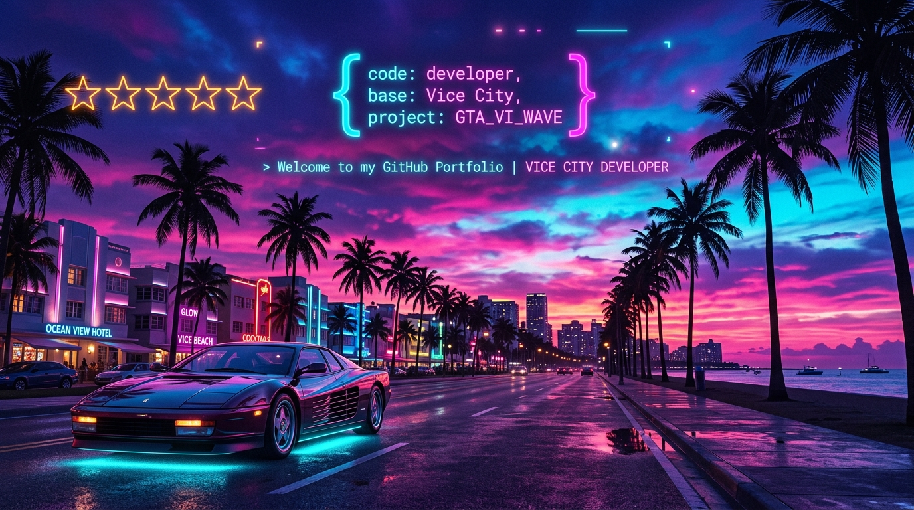

<div align="center">

  <!-- GTA 6 THEMED BANNER -->
  <!-- You can switch between ./assets/banner.jpg (Cinematic Wallpaper) or ./assets/banner.svg (Neon Vector) -->
  <a href="https://github.com/YOUR_GITHUB_USERNAME">
    
  </a>

  <br />
  <br />

  <!-- VICE CITY LOCATION HUD -->
  <h3>🌴 WELCOME TO LEONIDA // VICE CITY METRO 🌴</h3>

  <p>
    <b>WANTED LEVEL:</b> ⭐ ⭐ ⭐ ⭐ ⭐ &nbsp;|&nbsp;
    <b>HEALTH:</b> <code>[████████████████] 100%</code> &nbsp;|&nbsp;
    <b>ARMOR:</b> <code>[████████████████] 100%</code>
  </p>
  <p>
    <b>CASH:</b> <code>$9,999,999</code> &nbsp;|&nbsp;
    <b>CURRENT OBJECTIVE:</b> <code>BUILDING PRODUCTION-GRADE SOFTWARE &amp; CRACKING COMPLEX SYSTEMS</code>
  </p>

  <!-- SOCIAL / FREQUENCY BADGES -->
  <p>
    <a href="mailto:your.email@example.com">
      
    </a>
    <a href="https://linkedin.com/in/YOUR_LINKEDIN">
      
    </a>
    <a href="https://twitter.com/YOUR_TWITTER">
      
    </a>
    <a href="https://yourportfolio.com">
      
    </a>
  </p>

  
</div>

<br />

## 📂 CLASSIFIED DOSSIER // CHARACTER PROFILE

```yaml
Character:
  Alias: "YOUR_NAME_OR_HANDLE"
  Specialty: "Full-Stack Engineer // Cloud Architect // System Specialist"
  Base of Operations: "Vice City, Leonida (Remote Worldwide)"
  Primary Rig: "Arch Linux / macOS // Mechanical Keyboard // Coffee Injector"
  Current Bounty: "Building high-performance web applications and AI systems"
  Heist Philosophy: "Move fast, ship clean code, leave zero bugs behind."
```

* 🌆 **Day Job**: Engineering scalable software solutions, microservices, and modern web interfaces.
* 🕶️ **Night Ops**: Contributing to open-source software, tinkering with LLMs, and building creative side-heists.
* 📻 **Vice City Radio Preset**: *Synthwave / 80s Disco / Cyberpunk Beats*.
* 💼 **Looking for**: High-stakes contracts, full-time engineering roles, and innovative engineering crews.

<br />

---

## 🔫 THE WEAPON WHEEL // ARSENAL & TECH STACK

<div align="center">

### 🗡️ SIDEARMS & MELEE // CORE LANGUAGES
<p>
  
  
  
  
  
  
</p>

### 🔫 AUTOMATICS & RIFLES // FRONTEND & UI FRAMEWORKS
<p>
  
  
  
  
  
  
</p>

### 💣 HEAVY ARTILLERY // BACKEND, CLOUD & ORCHESTRATION
<p>
  
  
  
  
  
  
</p>

### 🏦 SAFE CRACKERS // DATABASES & CACHING
<p>
  
  
  
  
  
</p>

### 🕶️ HEIST GEAR // OPERATING SYSTEMS & WORKFLOW
<p>
  
  
  
  
  
  
</p>

</div>

<br />

---

## 💰 THE HEIST LOGS // FEATURED OPERATIONS

<table>
  <thead>
    <tr>
      <th width="30%">🎯 Operation / Target</th>
      <th width="45%">📋 Mission Briefing &amp; Arsenal</th>
      <th width="25%">🏆 Score &amp; Evidence</th>
    </tr>
  </thead>
  <tbody>
    <tr>
      <td>
        <b>Operation: Ocean View Gateway</b><br />
        <sub>High-Concurrency Distributed API</sub>
      </td>
      <td>
        Engineered a distributed realtime event streaming platform handling 25,000+ req/sec with sub-millisecond latencies.<br /><br />
        <code>Go</code> • <code>Redis</code> • <code>gRPC</code> • <code>Docker</code> • <code>Kafka</code>
      </td>
      <td>
        <a href="https://github.com/YOUR_GITHUB_USERNAME/ocean-view-gateway"><b>[📁 REPO]</b></a> &nbsp;
        <a href="https://example.com/demo"><b>[🚀 DEMO]</b></a><br /><br />
        
      </td>
    </tr>
    <tr>
      <td>
        <b>Operation: Vice City SynthUI</b><br />
        <sub>Component Library &amp; Design System</sub>
      </td>
      <td>
        A 90s retro-futuristic synthwave component library built for modern Next.js 14 and React web applications.<br /><br />
        <code>TypeScript</code> • <code>React</code> • <code>TailwindCSS</code> • <code>Radix UI</code>
      </td>
      <td>
        <a href="https://github.com/YOUR_GITHUB_USERNAME/vice-city-synthui"><b>[📁 REPO]</b></a> &nbsp;
        <a href="https://example.com/demo"><b>[🚀 DEMO]</b></a><br /><br />
        
      </td>
    </tr>
    <tr>
      <td>
        <b>Operation: Leonida AI Heist Agent</b><br />
        <sub>Autonomous Multi-Agent Orchestrator</sub>
      </td>
      <td>
        Autonomous LLM agent system that automates reconnaissance, code analysis, and test case generation in CI/CD.<br /><br />
        <code>Python</code> • <code>FastAPI</code> • <code>LangChain</code> • <code>ChromaDB</code>
      </td>
      <td>
        <a href="https://github.com/YOUR_GITHUB_USERNAME/leonida-ai-agent"><b>[📁 REPO]</b></a> &nbsp;
        <a href="https://example.com/demo"><b>[🚀 DEMO]</b></a><br /><br />
        
      </td>
    </tr>
  </tbody>
</table>

<br />

---

## 📊 POLICE DATABASE // COMMITS & PERFORMANCE STATS

<div align="center">
  <!-- Replace YOUR_GITHUB_USERNAME with your real GitHub handle -->
  
  
  
  <br />
  <br />

  
</div>

<br />

---

## 📻 VICE CITY RADIO // ON THE AIR

<div align="center">
  <p><b>NOW TUNED INTO:</b> <code>105.6 FLASH FM // SYNTHWAVE &amp; 80S DISCO NIGHTS</code></p>
  
  <!-- Optional Spotify Currently Playing Widget -->
  <!-- Set up via: https://github.com/novatorem/novatorem or keep static track -->
  <a href="https://open.spotify.com">
    
  </a>
</div>

<br />

---

## 🎮 CHEAT CODES // SECRET CONSOLE

<details>
<summary><b>🕹️ CLICK TO ENTER VICE CITY CHEAT CODES</b></summary>

<br />

| Button Combo | Cheat Activated | In-Game Effect |
| :--- | :--- | :--- |
| `↑ ↑ ↓ ↓ ← → ← → B A` | **GOD_MODE_COMMITS** | Instant 100% test coverage & clean builds |
| `R1, R2, L1, X, ←, ↓, →, ↑` | **SPAWN_ESPRESSO** | Infinite coffee supply directly to desk |
| `PROFESSIONALSKIT` | **WEAPON_SET_3** | High-end terminal, Neovim, and 4K Ultrawide monitor |
| `LEAVEMEALONE` | **CLEAR_WANTED_LEVEL** | Resolves all P0 production bugs instantly |
| `⭐ STAR THIS REPO` | **RESPECT_BOOST** | **+9999 RESPECT to the author!** |

</details>

<br />

<!-- FOOTER MISSION PASSED BADGE -->
<div align="center">
  
  <br />
  <sub>GTA VI Themed GitHub Profile • Designed for Developers in Vice City, Leonida 🌴</sub>
</div>
